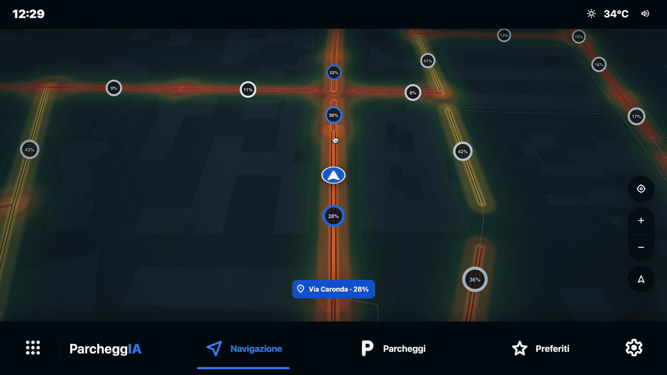
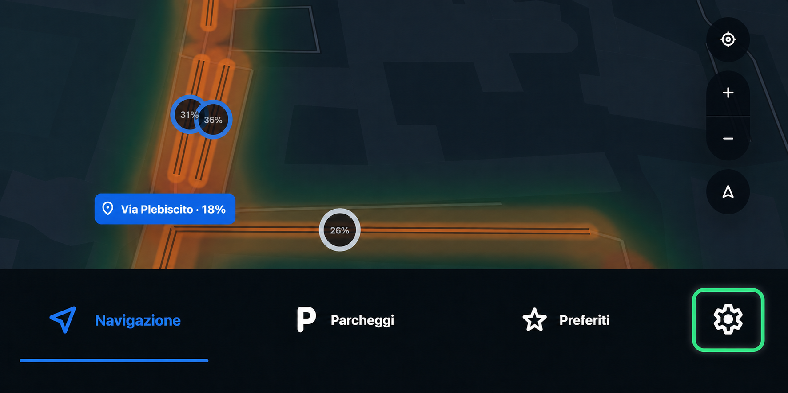
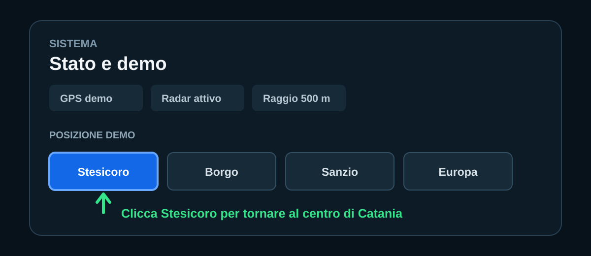
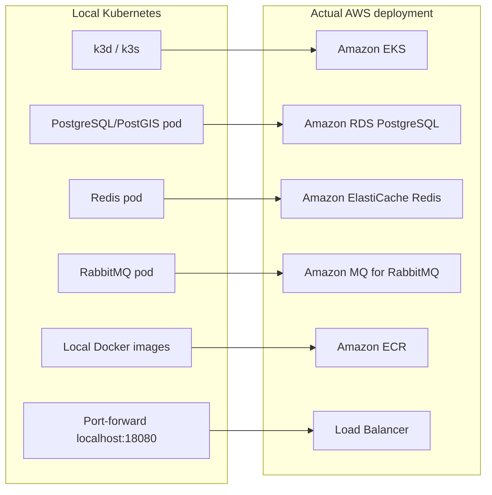
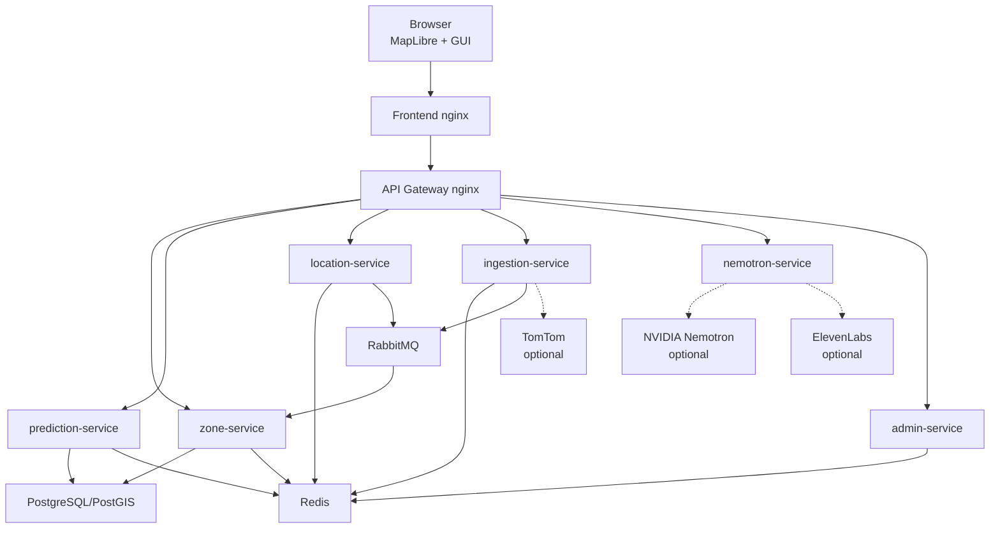
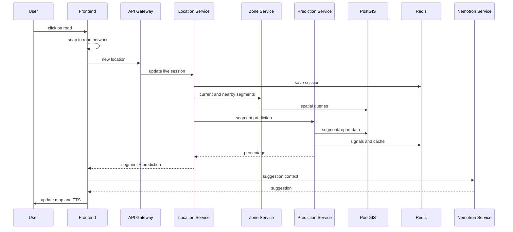

<p align="center">
  
</p>

# ParcheggIA

ParcheggIA is an app that estimates where users are most likely to find parking nearby.

Instead of saying "this area is full" or "this area is available", the app works with short road segments. The GUI displays a navigation-style map with a heatmap, percentages on segments, parking markers, AI suggestions and text to speech.

The project is designed to run in three ways:

- locally with Docker Compose;
- on local Kubernetes with k3d, to simulate a small cloud architecture;
- on AWS, using EKS, RDS, ElastiCache, Amazon MQ, ECR, VPC, Load Balancer, SSM, CloudWatch, Lambda and EventBridge.

No API keys are needed to try it. If TomTom, Nemotron or ElevenLabs are not configured, the app uses real OSM data, simulated estimates and local fallbacks.

<p align="center">
  
</p>

## Quick start

Prerequisites:

- Git;
- Docker or a compatible runtime;
- on macOS, Docker Desktop or Colima;
- on Windows, WSL2 with Docker Desktop is recommended;
- at least a few GB of free space for images, databases and containers.

Clone the repository and start everything:

```bash
git clone https://github.com/AlbertoBocchieri/Progetto-Sistemi-Cloud.git
cd Progetto-Sistemi-Cloud
docker compose up -d --build
```

Then open:

```text
http://localhost:8080
```

To check that the containers have started:

```bash
docker compose ps
```

To run a smoke test:

```bash
scripts/smoke_test.sh
```

To stop everything:

```bash
docker compose down
```

To also delete the database data and start from scratch:

```bash
docker compose down -v
```

The first startup may take a while because the database imports real OSM segments for Catania and applies overrides for blue-line paid parking spaces.

To explore the demo on a PC, **click directly on a road on the map**: the user marker moves and snaps to the road network. After a few seconds, the current segment, availability percentage, heatmap, nearby parking and suggestion are updated. The **Simulate 500 m drive (Simula guida 500 m)** button in **Settings (Impostazioni)** starts a short automated demo route.

> **Navigation note:** the navigation feature available in Settings has not been developed extensively, so its use is not recommended.

<p align="center">
  
</p>
<p align="center"><em>Actual example: changing roads updates the estimate and triggers a contextual suggestion.</em></p>

## Returning to the Catania demo

The app starts at Stesicoro, but the browser may ask for permission to use your actual location. If you are outside Catania and accept, the map moves to the detected location.

To return to the area covered by the demo:

1. click the **Settings (Impostazioni)** gear icon in the bottom-right corner;
2. in the **Status and demo (Stato e demo)** panel, click **Stesicoro**;
3. wait a few seconds while the heatmap, segments and predictions are updated.

<p align="center">
  
</p>

<p align="center"><em>Step 1: open Settings (Impostazioni) using the gear in the bottom-right corner.</em></p>

<p align="center">
  
</p>

<p align="center"><em>Step 2: select Stesicoro. Borgo, Sanzio and Europa are also valid demo locations.</em></p>

The crosshair button on the right uses **actual GPS coordinates**, so it may move the map outside Catania again. The navigation-arrow button recenters the view on the location already selected.

## Windows

On Windows, the most reliable approach is to use WSL2.

Recommended setup:

- install WSL2 with Ubuntu;
- install Docker Desktop;
- enable Docker Desktop integration with Ubuntu/WSL;
- clone the repository inside the Linux filesystem, for example at `~/Progetto-Sistemi-Cloud`;
- run commands from the Ubuntu terminal rather than PowerShell;
- open the app in your Windows browser at `http://localhost:8080`.

Example:

```bash
sudo apt update
sudo apt install -y git curl
git clone https://github.com/AlbertoBocchieri/Progetto-Sistemi-Cloud.git
cd Progetto-Sistemi-Cloud
docker compose up -d --build
```

If a script will not run because it is not executable:

```bash
chmod +x scripts/*.sh
```

## Simulating the cloud architecture locally

This mode simulates the project on local Kubernetes without creating AWS resources.

On macOS, you can install the tools with:

```bash
brew install colima k3d kubernetes-cli helm
```

If you use Colima:

```bash
scripts/colima_start.sh
```

Then start the simulation:

```bash
scripts/cloud_sim_local_up.sh
```

The script:

- creates or reuses a k3d cluster;
- builds the Docker images;
- imports them into the cluster;
- deploys PostgreSQL/PostGIS, Redis, RabbitMQ and the microservices;
- imports OSM data;
- runs a smoke test;
- exposes the frontend at:

```text
http://localhost:18080
```

The terminal must remain open to keep the port forwards running.

To shut it down:

```bash
scripts/cloud_sim_local_down.sh
```

The local simulation roughly maps to AWS as follows:



## Deploying to AWS

Requirements:

- an AWS account;
- a configured AWS CLI;
- Terraform;
- kubectl;
- Docker;
- permissions for EKS, EC2/VPC, ECR, RDS, ElastiCache, Amazon MQ, SSM, CloudWatch, Lambda and EventBridge.

Configure an AWS profile:

```bash
aws configure --profile parcheggia-dev
```

`parcheggia-dev` will be the local AWS CLI profile name. During this command, copy the values from the access-key CSV downloaded from AWS:

```text
AWS Access Key ID: value from the "Access key ID" column
AWS Secret Access Key: value from the "Secret access key" column
Default region name: eu-south-1
Default output format: json
```

Verify:

```bash
aws sts get-caller-identity --profile parcheggia-dev
```

### AWS secrets with SSM

In the cloud deployment, passwords and API keys are not stored in the repository. They are saved in AWS Systems Manager Parameter Store, available in the AWS console under:

```text
Systems Manager -> Parameter Store
```

The project uses this prefix:

```text
/parcheggia/dev
```

The main parameters are:

```text
/parcheggia/dev/secrets/postgres-password
/parcheggia/dev/secrets/rabbitmq-password
/parcheggia/dev/secrets/tomtom-api-key
/parcheggia/dev/secrets/nemotron-api-key
/parcheggia/dev/secrets/elevenlabs-api-key
/parcheggia/dev/secrets/github-actions-token
```

PostgreSQL and RabbitMQ passwords are required for the cloud deployment. TomTom, Nemotron and ElevenLabs keys are optional: without them, the app still starts and uses simulations/fallbacks. Sensitive values are stored as `SecureString`, so they must not be printed in logs or copied into Kubernetes manifests.

To upload values from a local `.env` file to SSM:

```bash
export AWS_PROFILE=parcheggia-dev
export AWS_REGION=eu-south-1
scripts/aws_ssm_sync_env.sh
```

To check that the parameters exist without displaying their values:

```bash
scripts/aws_ssm_check_config.sh
```

Before running the first Terraform plan on a new account, create the S3 bucket that stores the remote state:

```bash
scripts/terraform_backend_bootstrap.sh
```

The bucket name is derived from the active AWS account, for example `parcheggia-dev-terraform-state-<account-id>-eu-south-1`. The plan, startup and shutdown scripts automatically use the same bucket; the repository does not hardcode a specific account ID.

During deployment, the script:

1. reads Terraform outputs, such as the RDS, Redis and RabbitMQ endpoints;
2. reads secrets from SSM;
3. creates a `ConfigMap` in the Kubernetes cluster for regular configuration;
4. creates a Kubernetes `Secret` for passwords and API keys, if present.

In practice, pods do not read directly from SSM: they receive environment variables through Kubernetes `ConfigMap` and `Secret` resources generated by the scripts.

To preview what would be created:

```bash
scripts/cloud_plan.sh
```

To start the cloud demo:

```bash
CONFIRM_APPLY=apply-parcheggia-dev scripts/cloud_demo_up.sh
```

To shut it down:

```bash
CONFIRM_DESTROY=destroy-parcheggia-dev scripts/cloud_down.sh
```

The project also includes automatic shutdown with Lambda/EventBridge, scheduled automatically during cloud deployment to shut everything down after 4 hours.
You can still check its status with:

```bash
scripts/cloud_status.sh
```

## What works without API keys

The demo is designed to start even without external keys.

Without API keys:

- the map works;
- real OSM segments are loaded;
- the heatmap is displayed;
- percentages are simulated realistically;
- AI suggestions have a local fallback;
- TTS can use the browser;
- TomTom, Nemotron and ElevenLabs are not called.

With API keys configured:

- TomTom improves estimates with traffic, incidents and parking POIs;
- Nemotron generates actual AI suggestions;
- ElevenLabs generates a more natural voice.

The keys are never exposed.

## Architecture

This is the overall structure:



The browser communicates only with the gateway. This matters because:

- API keys stay in the backend
- usage of external APIs can be controlled
- the frontend does not need to know the internal structure

## Technology stack

| Component | Technologies |
|---|---|
| Frontend | HTML, CSS, vanilla JavaScript |
| Map | MapLibre GL JS, PMTiles |
| Backend | Python FastAPI |
| Gateway | Nginx |
| Database | PostgreSQL + PostGIS |
| Cache/state | Redis |
| Events | RabbitMQ |
| AI | NVIDIA Nemotron, with fallback |
| TTS | ElevenLabs, with browser fallback |
| Containers | Docker |
| Local development | Docker Compose |
| Local Kubernetes | k3d/k3s |
| Cloud | AWS EKS, RDS, ElastiCache, Amazon MQ, ECR, VPC, Load Balancer, SSM Parameter Store, CloudWatch, Lambda, EventBridge |
| IaC | Terraform |
| CI/CD | GitHub Actions |

React, TypeScript and Spring Boot were not used. They were considered initially, but the project ultimately adopted a simpler solution: a vanilla frontend, an Nginx gateway and FastAPI microservices.

## Local services

| Service | Port | Purpose |
|---|---:|---|
| `frontend` | 8080 | Serves the GUI |
| `api-gateway` | 8000 | Routes requests to services |
| `zone-service` | 8001 | Segments, roads, reports, geographic data |
| `ingestion-service` | 8002 | TomTom, demo scenarios, events |
| `nemotron-service` | 8003 | AI suggestions and TTS |
| `prediction-service` | 8004 | Percentage and heatmap calculations |
| `location-service` | 8005 | Live sessions and user location |
| `admin-service` | 8006 | Diagnostics and demo reset |
| `postgres` | 5432 | PostgreSQL/PostGIS |
| `redis` | 6379 | Cache and live state |
| `rabbitmq` | 5672 / 15672 | Event broker and web interface |

RabbitMQ Management:

```text
http://localhost:15672
username: parcheggia
password: parcheggia
```

## Frontend

The frontend is deliberately simple: no framework and no complex build process. MapLibre is the interesting part.

Main files:

- `frontend/index.html`
- `frontend/styles.css`
- `frontend/app.js`
- `frontend/assets/catania.pmtiles`

The GUI displays:

- user location;
- a continuous heatmap across segments;
- percentage markers;
- parking markers;
- AI suggestions;
- TTS;
- dark/light theme;
- driving simulation.

Some important constants in `frontend/app.js`:

```text
LOCAL_RADIUS_M = 500
PARKING_POI_RADIUS_M = 500
ROAD_NETWORK_RADIUS_M = 700
MAP_DEFAULT_ZOOM = 18.6
MAP_TRACKING_ZOOM = 19.1
TOMTOM_PREDICTION_REFRESH_MS = 5 minutes
```

The basemap is local:

```text
frontend/assets/catania.pmtiles
```

This means no keys are needed for MapTiler, Stadia or TomTom Map Display.

## Backend

### API Gateway

The gateway is Nginx. It receives requests from the browser and forwards them to the appropriate service.

Examples:

- `/api/v1/live-sessions` goes to `location-service`;
- `/api/v1/segment-heatmap` goes to `prediction-service`;
- `/api/v1/tomtom/...` goes to `ingestion-service`;
- `/ai/...` goes to `nemotron-service`;
- many segment APIs go to `zone-service`.

### Zone Service

Handles geographic features:

- road segments;
- the current segment;
- nearby segments;
- the road network;
- reports;
- the RabbitMQ consumer;
- legacy zone APIs.

It uses PostGIS for spatial queries and Redis for caching/signals.

### Prediction Service

Calculates the probability of finding parking as a percentage.

The model is rule-based and does not use machine learning.
It takes into account:

- parking type;
- user reports;
- Redis signals;
- TomTom data, if available;
- time and day;
- distance.

The parking availability calculation is:

```text
percentage =
  parking_type_baseline
  + report_adjustment
  + tomtom_or_simulated_traffic_adjustment
  + incident_adjustment
  + time_adjustment
  + distance_adjustment
```

The result is then normalized to a value between `0` and `100`.

The initial baselines are:

```text
blue-line paid parking   42%
probably free            48%
restricted               14%
unknown                  42%
```

The main adjustments to this percentage come from:

- recent user reports, which can shift the estimate by around `-15/+15`;
- real or simulated traffic and incidents, which can shift it by around `-35/+20`;
- time of day, which lowers the estimate during busy hours and improves it slightly at night or on weekends;
- segments farther from the user, which carry less weight than nearby ones.

Alongside the percentage, the system also calculates `confidence`: how much it trusts the estimate. An estimate based on recent real data and consistent reports has higher confidence, while an estimate based only on simulated or inferred data is more cautious.

The visual states are:

```text
< 20%      very difficult
20-39%     difficult
40-59%     uncertain
60-79%     good
>= 80%     favorable
```

### Location Service

Tracks the user's live session.

When a new location arrives, it:

- saves the session in Redis;
- asks `zone-service` for the current segment;
- asks `prediction-service` for the estimate;
- publishes an event to RabbitMQ.

### Ingestion Service

Handles external data and demo scenarios.

With TomTom configured, it can use:

- Traffic Flow;
- Traffic Incidents;
- Search API to find nearby parking.

It also has a budget guard in Redis to limit API calls.

### Nemotron Service

Generates suggestions for the user.

If a Nemotron API key is present, it uses:

```text
nvidia/nemotron-3-nano-30b-a3b
```

Otherwise, it uses a simulated fallback.

For TTS, it uses ElevenLabs if configured; otherwise, the frontend can use the browser's TTS.

## Data model

The main database is PostgreSQL with PostGIS.

The main entities are:

- `parking_segments`: short road segments;
- `road_edges` and `road_nodes`: the road network used for snapping and simulation;
- `parking_lots`: parking lots;
- `segment_reports`: user reports about segments;
- legacy tables `zones` and `user_reports`, retained for compatibility.

Segments can have parking types such as:

- `blue`: blue-line paid parking;
- `probable_free`: probably free;
- `restricted`: restricted;
- `unknown`: unknown.

The geographic data uses EPSG:4326 coordinates and GIST indexes.

## OSM import

Road data comes from OpenStreetMap.

Important files:

- `data/osm/catania_segments.sql`
- `data/osm/catania_blue_overrides.sql`
- `scripts/import_osm_segments.py`
- `scripts/check_osm_import.py`

On the first startup, `db-init`:

1. creates the tables;
2. imports OSM segments if they are not already present;
3. applies overrides for blue-line paid parking.

We chose to import OSM into PostGIS instead of reading roads directly from MapLibre because map tiles are meant for rendering, not reliable analysis of segments, reports and predictions.

## TomTom

TomTom is used only by the backend; it is not called by the frontend.

The APIs used are:

- Traffic Flow API;
- Traffic Incidents API;
- Search API.

Traffic Flow provides information such as:

- current speed;
- free-flow speed;
- confidence;
- road closures.

Traffic Incidents provides information about:

- incidents;
- roadworks;
- delays;
- traffic queues;
- closed sections.

Search API is used to find nearby parking, not to determine how many spaces are available.

To reduce API calls:

- a local radius of 500 meters;
- cache cells of approximately 250 meters;
- a 5-minute TTL for predictions;
- a 24-hour TTL for parking POIs;
- a budget guard set to 5% of the monthly quota in test mode.

## AI and TTS

AI suggestions are generated using local context:

- the current road;
- the percentage;
- nearby segments;
- nearby parking;
- parking type;
- confidence.

The prompt requests short, practical advice in Italian, avoiding overly technical wording.

Example suggestion, translated into English here; suggestions in the app are in Italian:

```text
Continue along Via Caronda and look for blue-line paid parking 44 meters away; alternatively, head toward Via Palazzotto at 46%.
```

TTS:

- uses ElevenLabs if a key is available;
- uses the `eleven_flash_v2_5` model;
- sets similarity to 50%;
- sets style/exaggeration to 25%;
- otherwise uses the browser.

## Practical flow

When the user clicks on a road:



## Main APIs

Segments:

```text
GET /api/v1/segments
GET /api/v1/segments/current?lat=&lon=
GET /api/v1/segments/nearby?lat=&lon=&radius_m=500
GET /api/v1/segments/{segment_id}/prediction
GET /api/v1/segment-heatmap?bbox=&zoom=
POST /api/v1/segment-reports
```

Road network:

```text
GET /api/v1/road-network?lat=&lon=&radius_m=700
```

Live sessions:

```text
POST /api/v1/live-sessions/start
POST /api/v1/live-sessions/{session_id}/location
POST /api/v1/live-sessions/{session_id}/stop
```

TomTom:

```text
POST /ingestion/traffic/tomtom/publish
GET /ingestion/traffic/tomtom/budget
GET /api/v1/tomtom/parking-pois
```

AI:

```text
GET /ai/ready
POST /ai/explain
POST /ai/tts
```

Admin:

```text
GET /api/v1/admin/source-health
GET /api/v1/admin/events
POST /api/v1/admin/demo-scenarios/reset
```

## GitHub Actions

The repository contains workflows for:

- CI checks;
- Docker builds;
- building and pushing images to ECR;
- Terraform plan/apply;
- local k3d deployment;
- EKS deployment;
- cloud shutdown.

### What happens after a push

When a commit is pushed to `main`, GitHub Actions automatically runs the main workflows:

1. CI starts, runs static checks, starts the stack with Docker Compose and runs smoke tests/demo tests;
2. the Docker build starts and verifies that all service images can be built;
3. if the repository's AWS secrets are configured, the ECR build also starts;
4. the ECR workflow logs in to Amazon ECR, builds the images and publishes them to the AWS repositories;
5. each image is tagged with at least `latest` and the commit SHA, so the exact code version can be traced.

The ECR flow is:

```text
push to main
        ↓
GitHub Actions
        ↓
docker build for the services
        ↓
log in to Amazon ECR
        ↓
push images to ECR
        ↓
EKS can pull those images during deployment
```

A push to GitHub does not automatically trigger deployment to AWS. It updates the images in ECR, while EKS deployment remains a controlled step, run from a local script or a manual workflow, to avoid creating or updating cloud resources on every commit.


Main workflows:

- `.github/workflows/ci.yml`
- `.github/workflows/docker-build.yml`
- `.github/workflows/ecr-build.yml`
- `.github/workflows/deploy-local.yml`
- `.github/workflows/deploy-eks.yml`
- `.github/workflows/terraform-plan.yml`
- `.github/workflows/terraform-apply.yml`
- `.github/workflows/cloud-down.yml`

## Tests

Useful commands:

```bash
scripts/static_checks.sh
scripts/smoke_test.sh
scripts/e2e_demo_test.sh
scripts/check_frontend.py
scripts/check_tomtom.py
scripts/check_osm_import.py
scripts/check_road_backed_segments.py
scripts/check_scoring.py
```

For Kubernetes:

```bash
scripts/k8s_smoke_test.sh
```

For basic load testing:

```bash
scripts/load_test.sh
```


### The first startup is slow

This is normal. The database is importing OSM segments.

Check:

```bash
docker compose logs db-init
```

## Repository structure

```text
frontend/                         MapLibre GUI
services/api-gateway/             Nginx gateway
services/zone-service/            segments, roads, reports
services/prediction-service/      parking availability calculation
services/location-service/        live sessions
services/ingestion-service/       TomTom and demo scenarios
services/nemotron-service/        AI suggestions and TTS
services/admin-service/           diagnostics
data/osm/                         OSM data and overrides
infrastructure/k8s/               Kubernetes manifests
infrastructure/terraform/aws/     AWS infrastructure
infrastructure/ansible/           local playbooks
scripts/                          startup, test and deployment scripts
docs/                             additional documentation
```

## Additional documentation

For more details:

- `docs/architecture.md`
- `docs/data-model.md`
- `docs/cloud-deployment.md`
- `docs/kubernetes-local.md`
- `docs/iac-aws.md`
- `docs/event-flow.md`
- `docs/test-plan.md`
- `docs/verification-matrix.md`
